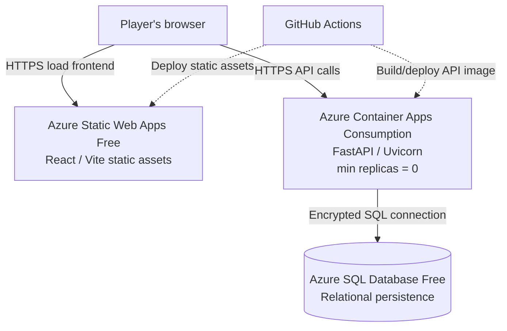

# Wordle Golf — Architecture

**Status:** Planned architecture  
**Last reviewed:** 2026-11-14  
**Scope:** Small, public portfolio game; approximately 10 daily players initially.

## Goals

- Build a Wordle-inspired golf game with rounds, guesses, player participation and scores.
- Deliver an immediately accessible frontend while allowing the API to sleep when unused.
- Minimise recurring Azure spend without claiming that the entire solution is guaranteed free.
- Keep boundaries clear so each component can be developed, tested and deployed independently.
- Demonstrate design choices, security, testing, IaC and CI/CD in a public repository.

## Planned production architecture



**Important:** In the Free plan, the React app calls the *separate* Container Apps HTTPS endpoint directly. Configure CORS on FastAPI to allow only the deployed frontend origin(s). Integrated Static Web Apps backend linking is a different feature and may require a paid plan. The browser **never** accesses Azure SQL directly.

## Technology choices

| Layer | Technology | Notes |
|---|---|---|
| Frontend | React, JavaScript, Vite, plain CSS | Learn fundamentals before introducing TypeScript or a UI framework |
| Frontend hosting | Azure Static Web Apps Free | Static assets are available independently of API scale-to-zero |
| Backend | Python, FastAPI, Uvicorn | Stateless REST API; containerised via Docker |
| Backend hosting | Azure Container Apps Consumption | HTTP ingress enabled; `minReplicas: 0`; monitor cold starts |
| Database | Azure SQL Database Free | Tables for players, games, participation, rounds, guesses and results |
| Images | Azure Container Registry (candidate) | Can incur charges even when Container Apps stays within free allowances; assess alternatives before provisioning |
| CI/CD | GitHub Actions | Lint, test, build; deploy using OIDC where supported |
| IaC | Azure Bicep | Introduce once Azure resources are actually needed |
| Local development | Vite + FastAPI; Docker later | No Azure dependencies for first frontend milestones |

## Runtime behaviour

1. A player opens the app: Static Web Apps serves HTML, CSS and JavaScript immediately.
2. React can render the game shell or local practice mode before the API responds.
3. The browser sends requests to FastAPI over HTTPS.
4. Container Apps starts a backend replica if there are none running; first response may be delayed.
5. FastAPI validates inputs, evaluates or confirms authoritative game state, and queries Azure SQL.
6. The UI shows loading/retry/error states and updates when the API responds.

## Key engineering decisions

- **Separate frontend and API:** independent deploys, static content served without backend cold starts.
- **Relational database:** appropriate for players, matches, rounds, guesses and scoring history.
- **Backend owns authoritative multiplayer state:** never trust client-reported scores or submitted outcomes.
- **Stateless API:** no irreplaceable state on container disk; safe to scale to zero or multiple replicas.
- **API configuration:** frontend reads a public API base URL from Vite build-time configuration; secrets remain exclusively server-side.
- **Security:** restrict CORS origins; use identity-based database access where feasible; validate inputs; add authentication only when needed.
- **Observability:** basic health checks and useful logs, with retention and budget limits.

## Example domain model (to be refined)

- `players`: public player profile / identity reference.
- `games`: a golf competition or session.
- `game_players`: relationship between games and players.
- `rounds`: ordered holes/words within each game.
- `guesses`: per-player attempts associated with a round.
- `round_scores`: authoritative per-player, per-round results.

**Open design questions:** guest vs authenticated accounts; private game invitations; who selects words; word-list source and licensing; number of holes per game; tie-break rules; whether rounds are simultaneous or asynchronous. Decide these in documented issues/ADRs before implementing backend contracts.

## Cost, availability and limitations

- Static Web Apps Free provides static hosting, but the chosen plan has quota/features restrictions.
- Container Apps Consumption can scale to zero; there may be API cold starts, and other attached resources may generate charges.
- Azure SQL Free is subject to eligibility and monthly free limits. Select **auto-pause when the free monthly allowance is exhausted** to avoid overage billing; the database then becomes unavailable until its allowance resets.
- Azure SQL Free also pauses after idle periods, so **both API and DB may have wake-up delays**. Don't keep open DB connections solely to avoid cold starts: doing so can prevent the SQL database from auto-pausing.
- Free Azure SQL is best treated as a hobby / proof-of-concept tier, not a production SLA.
- Azure Container Registry, logging, networking, domain registration and data egress require individual cost checks. Configure a budget and cost alerts before deployment.
- All cost and service-limit claims must be rechecked before provisioning resources.

## Repository target structure

```text
wordle-golf/
├── AGENTS.md
├── README.md
├── .gitignore
├── .github/
│   └── workflows/
├── docs/
│   ├── ARCHITECTURE.md
│   ├── learning-log.md           # When learning begins
│   └── decisions/               # When a real decision arises
├── frontend/                    # Vite application
├── backend/                     # Added in a later milestone
└── infra/                       # Bicep, added when deploying
```

Directories marked as later milestones should not be scaffolded prematurely.

## References

- [Azure Container Apps scaling](https://learn.microsoft.com/en-us/azure/container-apps/scale-app)
- [Azure SQL Database free offer](https://learn.microsoft.com/en-us/azure/azure-sql/database/free-tier)
- [Azure SQL free offer FAQ](https://learn.microsoft.com/en-us/azure/azure-sql/database/free-tier-faq)
- [Azure Static Web Apps plans](https://learn.microsoft.com/en-us/azure/static-web-apps/plans)
